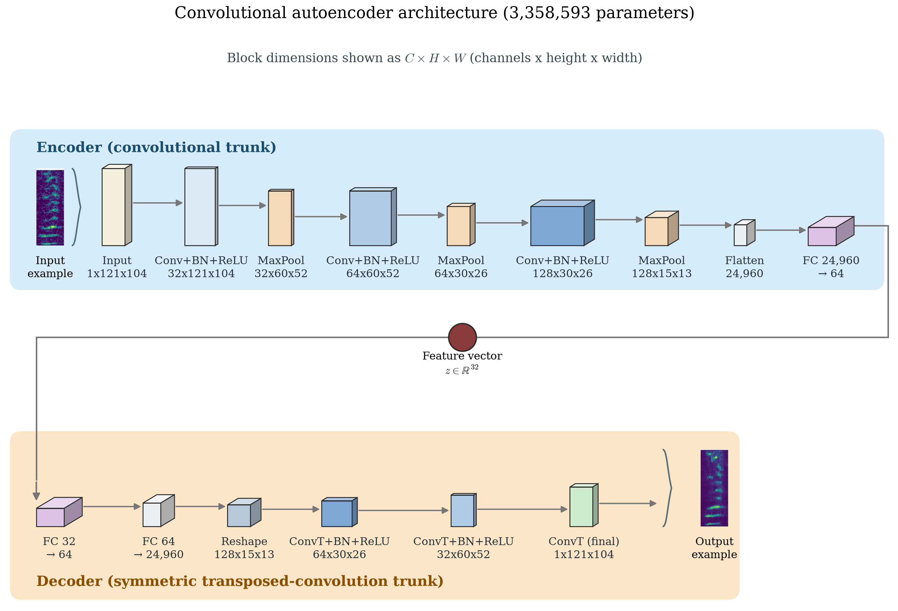
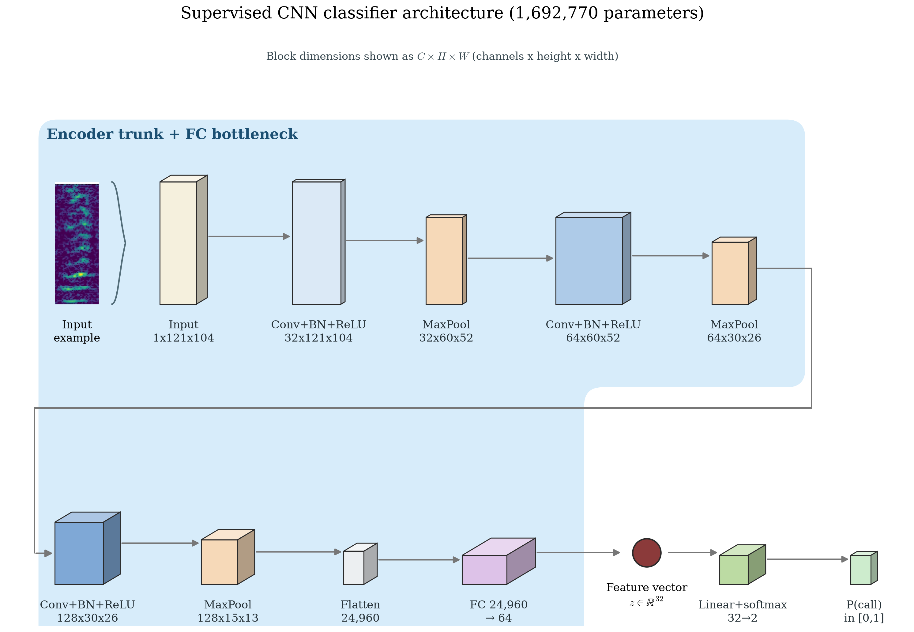

# Bowhead Whale Deep Learning Detection & Classification System

## Overview

This project develops deep learning methods for detecting, classifying, and range-estimating bowhead whale calls in the Alaskan Beaufort Sea. The work builds upon previously established automated procedures for detecting and localizing frequency-modulated bowhead whale sounds in the presence of seismic airgun surveys, as described in Thode et al. (2012).

The original automated procedure was applied to four years of data collected from over 30 directional autonomous recording packages deployed across a 280 km span of continental shelf in the Alaskan Beaufort Sea. That system used cascaded neural networks trained on 219,471 manually flagged bowhead call examples from 2008 and 2009, achieving comparable spatial and temporal call distributions to manual analysis methods while processing substantially more data.

This repository extends that foundation by implementing modern deep learning architectures using PyTorch, focusing on unsupervised and semi-supervised approaches for feature extraction and call classification.

## Acknowledgments

This work was recommended to the Secretary of Commerce for funding under project 4509 (2410): "Development of a deep learning bowhead whale call detector, classifier, and range estimator."

## Repository Structure

### `/Pytorch_scripts/`
Core deep learning implementation scripts using PyTorch for training and applying autoencoder models to bowhead whale acoustic data.

#### Main Training Scripts

- **`Autoencoder_v02_LD16_20251118.py`** - Convolutional autoencoder with 16-dimensional latent space. Optimized for quick iterations with reduced output samples and efficient visualization. Includes t-SNE and UMAP dimensionality reduction for latent space exploration.

- **`Autoencoder_v02_LD32_20251118.py`** - Convolutional autoencoder with 32-dimensional latent space. Similar architecture to LD16 but with higher-dimensional latent representation for capturing more complex acoustic features.

- **`Autooencoder_11132025.py`** - Earlier autoencoder implementation with alternative architecture configurations.

#### Application Scripts

- **`Apply_Autoencoder.py`** - Inference script that loads a trained autoencoder model and extracts latent space vectors from acoustic spectrogram images. Processes images in batches and saves results as MATLAB-compatible .mat files for downstream analysis.

#### Utility Scripts

- **`check_dataset_size.py`** - Diagnostic tool for verifying dataset file counts in airgun and whale call directories. Helps ensure data availability before training runs.

#### Archived Scripts

The `Archived_Scripts/` directory contains earlier development versions and experimental implementations, including:
- Alternative autoencoder architectures
- Jupyter notebook implementations
- Diagnostic and demonstration scripts for analyzing model behavior
- Reconstruction quality assessment tools

### `/matlab/`
MATLAB preprocessing and analysis scripts for:
- Creating spectrogram datasets from raw acoustic data
- Computing directional and bearing metrics
- Evaluating overlap between manual and automated detections
- Clustering analysis and visualization
- Database indexing and assembly

Key master scripts:
- `master_create_datasets.m` - Generate spectrogram datasets
- `master_cluster_analysis.m` - Perform clustering analysis on features
- `master_replot_cluster_analysis.m` - Generate t-SNE visualizations
- `master_assemble_unsupervised_database.m` - Assemble unsupervised training database

### `/models/`
Trained model checkpoints and unsupervised databases:
- `combined_ae_*/` - Combined autoencoder models
- `trained_models/` - Production model weights
- `Unsupervised_database_*.dir/` - Preprocessed acoustic feature databases

### `/plots/`
Model visualizations, training curves, and analysis figures including:
- Model architecture schematics
- Training loss plots
- t-SNE and UMAP embeddings of latent space
- Cluster analysis results

### `/results/`
Training outputs, extracted features, and analysis results from model runs.

### `/Azigram_pulse_detector.dir/`
Specialized scripts for detecting pulses in azimuthal spectrograms (azigrams), including weighted median calculations and master tracking routines.

### `/OutreachProject/`
Interactive browser-based tools for education and outreach:
- **Whale Call Theremin** - Interactive Theremin-style synthesizer for playing back bowhead whale calls
- Browser-based GUI with real-time frequency visualization
- 7 call types with ~70,000 classified examples from the Beaufort Sea
- Extracts frequency contours from spectrograms and synthesizes audio using Web Audio API
- See [OutreachProject/README_WHALE_PLAYER.md](OutreachProject/README_WHALE_PLAYER.md) for usage instructions

## Workflow

### Data Preparation (MATLAB)
1. Extract spectrograms from raw GSI acoustic recordings
2. Apply directional processing and bearing extraction
3. Assemble unsupervised databases with and without airgun contamination
4. Generate normalized spectrogram images for deep learning

### Model Training (PyTorch)
1. Configure autoencoder architecture (latent dimension, channels, layers)
2. Train on spectrogram image databases
3. Monitor reconstruction quality and latent space organization
4. Extract embeddings for clustering and classification

### Analysis and Visualization
1. Apply trained encoder to new acoustic data
2. Extract latent feature vectors
3. Perform clustering analysis (K-means, hierarchical)
4. Visualize embeddings with t-SNE/UMAP
5. Evaluate detection and classification performance

## How the CNN detector and autoencoder work

Every raw sound in this project — a whale call, a seismic airgun pulse, or
background noise — is first converted into a small grayscale image called a
**spectrogram**: a 3-second, 121-pixel (frequency, 0–500 Hz) by 104-pixel
(time) picture of how loud each frequency is at each moment. Both detectors
below work by looking at these 121×104 images, not the raw sound wave. A
PyTorch port of this pipeline, including training/evaluation scripts, lives
in [`bowhead/`](bowhead/) in this repository.

### The autoencoder: an unsupervised "feature finder"

The convolutional autoencoder (CAE) is trained with **no labels at all** —
it is never told which images are whale calls. Instead it is given a simple
task: look at a spectrogram, squeeze it down into just **32 numbers** (the
*latent vector*), and then try to redraw the original spectrogram from only
those 32 numbers. Because the network is forced through this narrow
32-number "bottleneck," it can't memorize every pixel — it has to learn
which handful of underlying features (the shape of a frequency sweep, its
duration, how it rises or falls) are most useful for reconstructing the
image. Those 32 numbers end up acting like a compact fingerprint of the
sound's time-frequency shape.

Concretely, the encoder half shrinks the image through three convolutional
blocks (each a 3×3 convolution + batch normalization + ReLU + 2×2 max-pool),
taking the channel depth from 1 → 32 → 64 → 128 while shrinking the spatial
size from 121×104 down to 15×13; this is flattened and passed through two
fully-connected layers down to the final 32-D latent vector. The decoder
half mirrors this in reverse (two fully-connected layers back up, then
three transposed-convolution layers) to reconstruct the 121×104 image from
those same 32 numbers, so reconstruction quality is a direct check on how
much real information survived the squeeze:



Once trained, this 32-D latent space is useful two ways:
1. **As a detector with no extra training** — take the latent vector of a
   new spectrogram, find its `k` nearest neighbors (by Euclidean distance)
   among a pool of already-labeled training spectrograms, and use the
   fraction of those neighbors that are whale calls as a call-probability
   score ("AE+kNN", `k`=40 in the paper). See
   [`bowhead/eval/ae_knn_baseline.py`](bowhead/eval/ae_knn_baseline.py).
2. **As a warm-start for the supervised classifier below**, by reusing its
   trained encoder weights instead of starting from random ones.

### The CNN detector: a supervised call / non-call classifier

The supervised CNN reuses the *exact same* three-convolutional-block encoder
trunk described above, but instead of a decoder it attaches a small
classification head — a single linear layer that turns the 32-D latent
vector into a call vs. non-call probability — and is trained end-to-end
(every weight, including the encoder's, keeps updating) on labeled
examples using a cross-entropy loss:



Two versions of this CNN were compared, differing only in how the encoder's
weights are set before training starts:
- **Cold-start ("scratch")** — the whole network, encoder included, starts
  from random weights.
- **Warm-start** — the encoder is initialized from the already-trained
  autoencoder above (only the new classification head starts random).

In this dataset the two end up performing almost identically (within 0.004
average precision of each other), so the simpler cold-start CNN is the one
used throughout the paper and the `bowhead/` pipeline.

### Running the detectors yourself

```bash
# Train the autoencoder from scratch on a spectrogram .npz dataset
PYTHONPATH=. python -m bowhead.train.train_ae --data data/spectrograms_100k_matched.npz --out-dir runs/ae_full

# Train the supervised CNN — cold-start (default) ...
PYTHONPATH=. python -m bowhead.train.train_cnn --data data/spectrograms_100k_matched.npz --tag scratch

# ... or warm-started from a trained autoencoder checkpoint
PYTHONPATH=. python -m bowhead.train.train_cnn --data data/spectrograms_100k_matched.npz \
  --warm-start runs/ae_full/autoencoder_clean.pt --tag warmstart

# Score a trained CNN checkpoint against a directory of raw .mat spectrograms
PYTHONPATH=. python -m bowhead.eval.score_eval_dataset \
  --eval-dir /path/to/Evaluation_200K.dir --model scratch runs/scratch/best.pt
```

## Dependencies

### Python Environment
- PyTorch (deep learning framework)
- NumPy, SciPy (numerical computing)
- scikit-learn (clustering, dimensionality reduction)
- UMAP-learn (manifold learning)
- matplotlib (visualization)
- tqdm (progress tracking)

A virtual environment configuration is provided in `.venv_py31018/`.

### MATLAB
- Signal Processing Toolbox
- Statistics and Machine Learning Toolbox
- Image Processing Toolbox (for spectrogram generation)

## References

Thode, A. M., Kim, K. H., Blackwell, S. B., Greene, C. R., Jr., Conrad, A. S., & Michael, A. (2012). Automated detection and localization of bowhead whale sounds in the presence of seismic airgun surveys. *The Journal of the Acoustical Society of America*, 131(5), 3726–3747. https://doi.org/10.1121/1.3699247

v0.01 Autoencoder architecture inspired by Duane, Daniel & Kroeger, Nicholas & Freeman, Simon & Freeman, Lauren. (2025). Unsupervised clustering of biological sounds in a Hawaiian coral reef. The Journal of the Acoustical Society of America. 157. A49-A49. 10.1121/10.0037353. 

## Contact

For questions about this codebase, please refer to the repository maintainers or the associated project documentation.

---

*This research contributes to long-term acoustic monitoring efforts in the Arctic and advances automated bioacoustic analysis methods for marine mammal conservation.*
